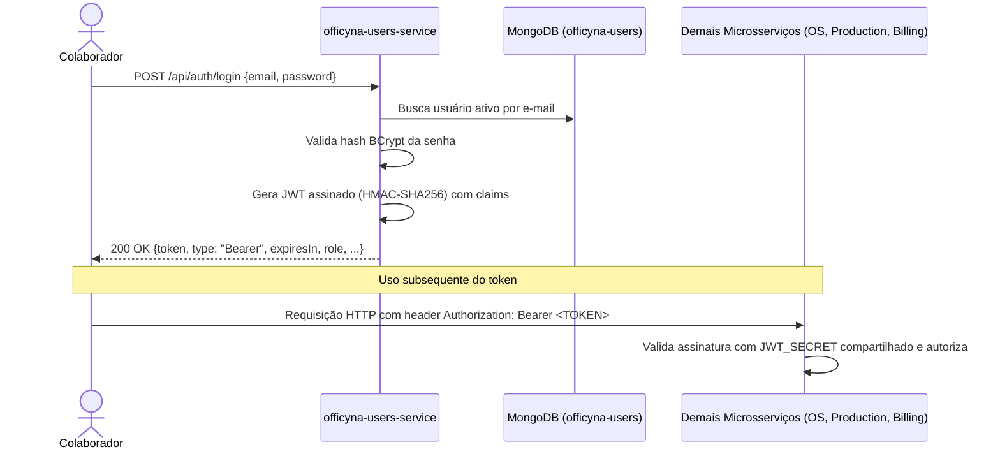

# 👤 Officyna - Microsserviço de Usuários e Autenticação (Users Service)

> **Tech Challenge - Fase 4: Desacoplamento e Arquitetura de Microsserviços**

O **`officyna-users-service`** é o microsserviço responsável pela **gestão de usuários internos** (`ADMIN`, `MANAGER`, `ATTENDANT`, `MECHANIC`) e pelo **provedor centralizado de autenticação (emissão de tokens JWT)** do ecossistema **Officyna**.

Ele atua como o Identity Provider (IdP) dos colaboradores da oficina, emitindo tokens JWT stateless assinados com algoritmo HMAC-SHA256, consumidos e validados por todos os demais microsserviços da arquitetura (`officyna-os-service`, `officyna-execution-production` e `officyna-billing-service`).

---

## 📋 Sumário
* [Objetivo do Microsserviço](#-objetivo-do-microsserviço)
* [Stack Tecnológica](#-stack-tecnológica)
* [Perfis de Acesso (Roles)](#-perfis-de-acesso-roles)
* [Fluxo de Autenticação e JWT](#-fluxo-de-autenticação-e-jwt)
* [Endpoints REST](#-endpoints-rest)
* [Regras de Negócio](#-regras-de-negócio)
* [Arquitetura e Organização de Pacotes](#-arquitetura-e-organização-de-pacotes)
* [Persistência NoSQL](#-persistência-nosql)
* [Instruções de Execução](#-instruções-de-execução)
* [Variáveis de Ambiente](#-variáveis-de-ambiente)
* [Observabilidade](#-observabilidade)
* [Testes e Qualidade](#-testes-e-qualidade)
* [CI/CD e Deploy (Kubernetes / EKS)](#-cicd-e-deploy-kubernetes--eks)

---

## 🎯 Objetivo do Microsserviço

* **Identidade Centralizada:** Gerenciamento exclusivo dos colaboradores internos da oficina, desacoplado dos dados de clientes e ordens de serviço.
* **Provedor de Autenticação (JWT Provider):** Ponto único para autenticação de credenciais internas (`POST /api/auth/login`) e geração de tokens JWT contendo as *claims* de identificação e papéis (*roles*).
* **Validação Descentralizada (Stateless):** Os demais microsserviços não precisam fazer chamadas HTTP síncronas para validar sessões; apenas validam a assinatura criptográfica do JWT compartilhando o mesmo `JWT_SECRET`.
* **Isolamento de Dados:** Base de dados NoSQL exclusiva no MongoDB / Amazon DocumentDB (`officyna-users`).

---

## 🧰 Stack Tecnológica

| Camada | Tecnologia |
| :--- | :--- |
| Linguagem / Runtime | Java 21 |
| Framework | Spring Boot 4.0.x (Web, Data MongoDB, Security, Validation, Actuator) |
| Banco de Dados | MongoDB 7 (local) / Amazon DocumentDB (AWS) |
| Segurança | Spring Security (Stateless, BCrypt Password Encoder, DaoAuthenticationProvider) |
| Criptografia / Tokens | JJWT 0.12.x (`jjwt-api`, `jjwt-impl`, `jjwt-jackson`) - HMAC-SHA256 |
| Documentação | Springdoc OpenAPI (Swagger UI) |
| Mapeamento de Objetos | MapStruct + Lombok |
| Observabilidade | Logstash Logback JSON encoder, New Relic APM Agent, Correlation ID Filter |
| Testes Automatizados | JUnit 5, Mockito, Spring Security Test |
| Qualidade e Cobertura | JaCoCo (≥ 80%), SonarCloud, OWASP Dependency-Check |
| Conteinerização | Docker (multi-stage build), Docker Compose |
| Orquestração / Cloud | Kubernetes (Amazon EKS) com HPA (Horizontal Pod Autoscaler) |

---

## 👥 Perfis de Acesso (Roles)

Definidos no enum `UserRole`:

| Role | Código | Nome | Responsabilidades |
| :--- | :-: | :--- | :--- |
| `ADMIN` | `0` | Administrador | Acesso irrestrito a todas as operações, inclusive criação, atualização e exclusão lógica de usuários. |
| `ATTENDANT` | `1` | Atendente | Responsável pelo atendimento inicial, cadastro de clientes/veículos e abertura de ordens de serviço. |
| `MECHANIC` | `2` | Mecânico | Responsável pela realização de diagnósticos e execução prática dos serviços na oficina. |
| `MANAGER` | `3` | Gerente | Gestão operacional da oficina, com permissão para gerenciar e cadastrar usuários internos. |

---

## 🔐 Fluxo de Autenticação e JWT

O microsserviço autentica os usuários via e-mail e senha criptografada com **BCrypt**.



### Estrutura do Token JWT Emitido

O token JWT gerado possui o cabeçalho padrão HMAC-SHA256 e o seguinte *payload*:

```json
{
  "sub": "admin@officyna.com",
  "roles": "ADMIN",
  "id": "672459b3d1b64e5210998a12",
  "name": "Administrador",
  "email": "admin@officyna.com",
  "iat": 1731542400,
  "exp": 1731628800
}
```

> [!IMPORTANT]
> A chave `jwt.secret` (`JWT_SECRET`) deve ser mantida estritamente idêntica entre o `officyna-users-service` e todos os serviços consumidores (`officyna-os-service`, `officyna-execution-production`, etc.).

---

## 🌐 Endpoints REST

A documentação interativa completa está disponível via **Swagger UI** em `/swagger-ui.html`.

### 1. Autenticação — `/api/auth` (🔓 Público)

| Método | Rota | Descrição | Status HTTP |
| :--- | :--- | :--- | :-: |
| `POST` | `/api/auth/login` | Autentica usuário interno e retorna o Bearer Token JWT | `200`, `401`, `400` |

#### Exemplo de Requisição (`POST /api/auth/login`)
```json
{
  "email": "admin@officyna.com",
  "password": "admin"
}
```

#### Exemplo de Resposta:
```json
{
  "token": "eyJhbGciOiJIUzI1NiIsIn...",
  "type": "Bearer",
  "expiresIn": 86400000,
  "userId": "672459b3d1b64e5210998a12",
  "name": "Administrador",
  "role": "ADMIN"
}
```

---

### 2. Gestão de Usuários — `/api/users` (🔒 Requer Bearer Token)

| Método | Rota | Descrição | Permissão Requerida |
| :--- | :--- | :--- | :--- |
| `GET` | `/api/users` | Lista todos os colaboradores ativos | Usuário autenticado |
| `GET` | `/api/users/{id}` | Busca colaborador por ID | Usuário autenticado |
| `GET` | `/api/users/email/{email}` | Busca colaborador por e-mail | Usuário autenticado |
| `POST` | `/api/users` | Cria novo colaborador | **`ADMIN` ou `MANAGER`** |
| `PUT` | `/api/users/{id}` | Atualiza dados cadastrais (senha opcional) | Usuário autenticado |
| `DELETE` | `/api/users/{id}` | Desativação lógica (*soft delete*) | Usuário autenticado |

#### Exemplo de Criação de Usuário (`POST /api/users`)
```json
{
  "name": "João da Silva",
  "email": "joao.silva@officyna.com",
  "password": "SenhaSegura123",
  "userRole": "MECHANIC"
}
```

---

### 3. Infraestrutura e Saúde (🔓 Público)

| Método | Rota | Descrição |
| :--- | :--- | :--- |
| `GET` | `/actuator/health` | Health check da aplicação (`{"status": "UP"}`) |
| `GET` | `/swagger-ui.html` | Interface gráfica interativa do Swagger |
| `GET` | `/api-docs` | Especificação OpenAPI 3 em formato JSON |

---

## 📋 Regras de Negócio

1. **Permissão de Criação:** A criação de usuários internos (`POST /api/users`) é restrita a usuários com perfil **`ADMIN`** ou **`MANAGER`**. Caso outro perfil tente criar usuários, uma `UserBusinessException` com mensagem descritiva é lançada.
2. **Normalização de E-mail:** Todos os e-mails são tratados em minúsculas e sem espaços laterais (`trim().toLowerCase()`).
3. **E-mail Único:** Não é permitido cadastrar dois usuários ativos com o mesmo e-mail.
4. **Reativação Inteligente:** Caso um colaborador tenha sido desativado anteriormente (*soft delete*) e seja recadastrado com o mesmo e-mail, seu cadastro existente é atualizado, reativado (`active = true`) e a nova senha é aplicada.
5. **Criptografia de Senha:** As senhas nunca são persistidas em texto plano. O Spring Security utiliza `BCryptPasswordEncoder` para gerar o hash seguro.
6. **Exclusão Lógica (*Soft Delete*):** A exclusão via `DELETE /api/users/{id}` altera a flag `active = false`, preservando a integridade histórica de diagnósticos e serviços executados pelo mecânico em ordens de serviço passadas.

---

## 🏗️ Arquitetura e Organização de Pacotes

O microsserviço adota a **Clean Architecture** (Arquitetura Hexagonal), separando regras de domínio de frameworks externos:

```
br.com.officyna/
├── api/user/                         # Adaptadores de Entrada (REST API)
│   ├── controller/                   # UserController (implementação do contrato OpenAPI)
│   ├── handler/                      # UserExceptionHandler (captura de exceções e mapeamento HTTP)
│   ├── resources/                    # DTOs de entrada e saída (UserRequest, UserResponse, etc.)
│   └── UserApi.java                  # Interface OpenAPI com documentação Swagger
├── domain/user/                      # Núcleo de Domínio e Regras de Negócio (Puro)
│   ├── controller/                   # UserControllerAdapter (orquestração de chamadas)
│   ├── entity/                       # Entidades de Domínio (User, UserRole)
│   ├── exception/                    # Exceções de negócio (UserBusinessException, UserNotFoundException)
│   ├── mapper/                       # Mapeadores de Domínio para DTOs (MapStruct)
│   ├── presenter/                    # Formatadores de saída (UserPresenter)
│   ├── repository/                   # Porta de Saída (Interface UserRepository)
│   └── service/                      # Casos de uso (UserService: validações, hashing, CRUD)
├── infrastructure/                   # Adaptadores Secundários, Frameworks e Infraestrutura
│   ├── auth/                         # LoginRequest, LoginResponse, AuthService e AuthController
│   ├── config/                       # Configurações Spring (SecurityConfig, MongoConfig, SwaggerConfig)
│   ├── converter/                    # Conversores customizados (LocalDateTime)
│   ├── exception/                    # ErrorResponse e FallbackExceptionHandler global
│   ├── logging/                      # Correlation ID (Filtro HTTP + MDC + New Relic)
│   ├── persistence/                  # Implementação MongoDB (UserDocument, UserMongoRepository, Gateway)
│   └── security/                     # JwtService, JwtAuthenticationFilter, UserDetailsServiceImpl
└── seed/                             # Cargas iniciais (DatabaseSeeder, UserSeeder)
```

---

## 🗄️ Persistência NoSQL

O serviço utiliza o **MongoDB / Amazon DocumentDB** com banco de dados dedicado:

* **Database:** `officyna-users`
* **Coleção principal:** `users`
* **Estrutura do documento (`UserDocument`):**
  * `_id`: Identificador único (String / ObjectId gerado pelo MongoDB).
  * `name`: Nome completo do colaborador.
  * `email`: E-mail único e normalizado.
  * `password`: Hash criptografado (BCrypt).
  * `userRole`: Enum da role (`ADMIN`, `ATTENDANT`, `MECHANIC`, `MANAGER`).
  * `active`: Booleano para controle de exclusão lógica (*soft delete*).
  * `createdAt` / `updatedAt`: Timestamps de auditoria.

### Carga Inicial Automática (Seed)
Ao iniciar a aplicação com a propriedade `database.seed.enabled=true` (padrão em dev), o `UserSeeder` verifica a existência do usuário administrador. Se não existir, cria automaticamente:

* **E-mail:** `admin@officyna.com`
* **Senha:** `123456`
* **Role:** `ADMIN`

---

## 🚀 Instruções de Execução

### Pré-requisitos
* **Java JDK 21+**
* **Docker** e **Docker Compose**
* **Maven 3.9+** (opcional, wrapper `./mvnw` / `mvnw.cmd` incluído)

---

### Opção A: Infraestrutura no Docker + Aplicação na IDE/Terminal (Recomendado para Dev)

1. **Subir o banco de dados e Mongo Express via Docker:**
   ```bash
   docker compose up -d mongodb mongo-express
   ```
   * **MongoDB:** Disponível em `localhost:27017` (banco `officyna-users`).
   * **Mongo Express:** Interface administrativa em `http://localhost:8081` (`admin` / `admin`).

2. **Executar a aplicação Spring Boot:**
   ```bash
   # Windows (PowerShell / CMD)
   .\mvnw.cmd spring-boot:run

   # Linux / macOS
   ./mvnw spring-boot:run
   ```

   A aplicação iniciará na porta **`8083`**.

---

### Opção B: Stack Completa via Docker Compose

Para subir o banco de dados e a aplicação compilada em containers Docker:
```bash
docker compose up -d --build
```

Para visualizar os logs:
```bash
docker compose logs -f app
```

Para encerrar:
```bash
docker compose down
```

---

### 🌐 Acessos Locais

| Serviço | URL | Observação |
| :--- | :--- | :--- |
| **API (`officyna-users-service`)** | `http://localhost:8083` | Porta configurada via `SERVER_PORT` |
| **Swagger UI** | `http://localhost:8083/swagger-ui.html` | Interface OpenAPI interativa |
| **OpenAPI JSON** | `http://localhost:8083/api-docs` | Especificação OpenAPI 3 |
| **Health Check** | `http://localhost:8083/actuator/health` | Deve retornar `{"status": "UP"}` |
| **Mongo Express** | `http://localhost:8081` | Gerenciador web do MongoDB |

---

## ⚙️ Variáveis de Ambiente

| Variável | Valor Padrão | Descrição |
| :--- | :--- | :--- |
| `SERVER_PORT` | `8083` | Porta HTTP da aplicação |
| `MONGODB_URI` | `mongodb://localhost:27017/officyna-users` | String de conexão com o MongoDB/DocumentDB |
| `JWT_SECRET` | *(chave interna padrão)* | Segredo compartilhado HMAC-SHA256 para assinatura do JWT |
| `JWT_EXPIRATION` | `86400000` | Tempo de expiração do token em ms (padrão: 24 horas) |
| `DATABASE_SEED_ENABLED` | `true` | Ativa o seed inicial do usuário `admin@officyna.com` |
| `LOG_LEVEL_APP` | `INFO` | Nível de log dos pacotes da aplicação (`br.com.officyna`) |
| `LOG_LEVEL_SECURITY` | `INFO` | Nível de log do Spring Security |

---

## 📈 Observabilidade

* **Logs Estruturados em JSON:** Configurados via `logback-spring.xml` com o `logstash-logback-encoder`, facilitando a indexação e busca em ferramentas de agregação de logs (ex: CloudWatch, Datadog, ELK).
* **Correlation ID:** O filtro `CorrelationIdFilter` extrai o header `correlationId` (ou `X-Correlation-ID`) das requisições e o injeta no MDC (*Mapped Diagnostic Context*). Requisições sem o header têm um UUID gerado automaticamente.
* **New Relic APM:** Imagem Docker com agente Java embarcado (`newrelic/newrelic.jar`), enviando métricas de transações e tempos de resposta.
* **Health Check:** Endpoint `/actuator/health` monitorado por sondas do Kubernetes (*liveness* e *readiness probes*).

---

## 🧪 Testes e Qualidade

O projeto conta com **84 testes automatizados** cobrindo controladores REST, serviços de domínio, validações de senha, manipulação de JWT, tratamento de exceções e persistência.

### Executar a suíte de testes:
```bash
# Windows
.\mvnw.cmd clean test

# Linux / macOS
./mvnw clean test
```

### Validação completa de build e cobertura (JaCoCo):
```bash
# Windows
.\mvnw.cmd clean verify

# Linux / macOS
./mvnw clean verify
```

* O relatório HTML de cobertura é gerado em `target/site/jacoco/index.html`.
* A regra de *check* do JaCoCo exige **cobertura mínima de 80%** nas regras de domínio e casos de uso.

---

## ☁️ CI/CD e Deploy (Kubernetes / EKS)

O pipeline de entrega contínua está implementado em `.github/workflows/cicd.yml` e é acionado em pushes nas branches `main` e `developer` ou via `workflow_dispatch`:

1. **Build e Testes:** Execução do `mvn verify` e análise estática no **SonarCloud**.
2. **Build e Push Docker:** Criação da imagem multi-stage e publicação no **GitHub Container Registry (GHCR)** sob a tag `ghcr.io/officyna/officyna-users-service:sha-<commit>`.
3. **Deploy no Kubernetes (Amazon EKS):**
   * Conecta ao cluster EKS `eks-officyna-service` no namespace `officyna`.
   * Obtém o endpoint do cluster DocumentDB via **AWS SSM Parameter Store** (`/officyna/db/endpoint`).
   * Aplica manifests com substituição de variáveis (`k8s/deployment.yaml`, `k8s/service.yaml`, `k8s/hpa.yaml`, `k8s/configmap.yaml`, `k8s/secret.yaml`).
   * Configura o **HPA** para escalabilidade automática (1 a 3 réplicas com target de 70% de CPU).
   * Aguarda o rollout e reporta o endpoint público do Load Balancer no resumo da execução do GitHub Actions.
4. **Destroy:** Disparado manualmente via `workflow_dispatch` com confirmação para remoção segura dos recursos da aplicação no cluster.
